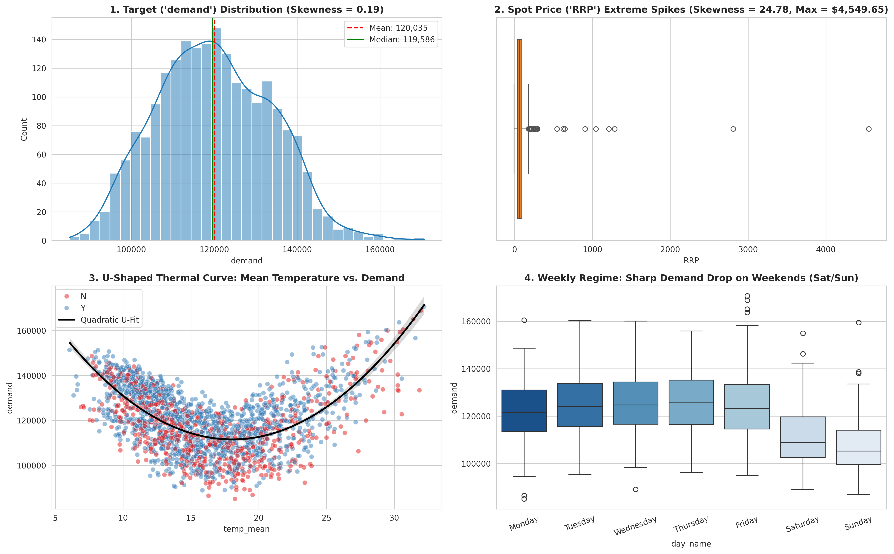
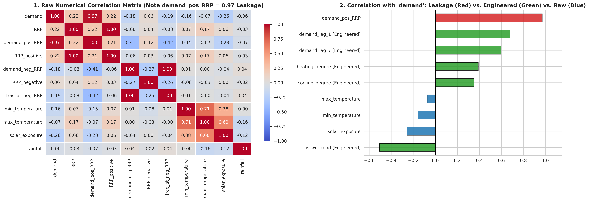

# ⚡ Victoria Daily Electricity Demand Forecasting
## 🎥 Interactive Demo & Walkthrough


https://github.com/user-attachments/assets/2431caf5-e63d-497d-8ff3-4a772eb16c35


### Leak-Free End-to-End Machine Learning Pipeline & Interactive Streamlit Forecaster


An end-to-end, production-grade machine learning system for forecasting daily electricity demand (`MWh`) across Victoria, Australia (`2,106` daily observations from January 2015 to October 2020). Built around a structured **6-Step ML Engineering Lifecycle** featuring custom Scikit-Learn transformers, strict chronological validation, automated MLflow experiment tracking, hyperparameter optimization, model card versioning, and a live Streamlit inference dashboard.

---

## 📌 Executive Summary & Engineering Highlights

Forecasting grid-level electricity load requires capturing non-linear weather dynamics, calendar regime shifts, and autoregressive market memory without leaking future information.

* **Strict Zero-Leakage Architecture:** Chronological train/validation/test partitioning (`70% / 15% / 15%`) is executed prior to any statistical fitting. All scalers, imputers, and outlier fences are learned exclusively on the training partition inside a modular Scikit-Learn `Pipeline` and `ColumnTransformer`.
* **Same-Day Settlement Leakage Elimination:** Raw dataset columns include post-settlement sub-demand variables (`demand_pos_RRP`, `demand_neg_RRP`) that sum directly to the daily target (`r = +0.97` linear correlation). Same-day settlement columns are stripped from day-`t` inputs and converted strictly into causal historical lags (`t-1`).
* **Physics-Informed Feature Engineering:** Decomposes raw temperatures (which exhibit a misleading near-zero linear correlation due to opposing winter heating and summer cooling slopes) into U-shaped thermal proxies (`heating_degree`, `cooling_degree`, `temp_mean_sq`) and calendar-regime interactions.
* **Production Generalization:** The tuned **Voting Ensemble** (`Ridge` + `Random Forest` + `Gradient Boosting`) achieved a **Validation R² of 0.9051 (`MAPE = 2.73%`)** and generalized to the unseen 2019–2020 test period with a **Test R² of 0.8647**, cutting prediction error by more than half compared to naive persistence baselines.

---

## 🏗️ End-to-End Pipeline Architecture (Step 1 → Step 6)

```text
Raw CSV (2,106 Unbroken Daily Records: 2015-01-01 to 2020-10-06)
  │
  ├─► Step 1: Configuration & Deterministic Reproducibility
  │      └── @dataclass PipelineConfig (Seeds, Split Ratios, Artifact & MLflow Paths)
  │
  ├─► Step 2: Diagnostic EDA & Target Leakage Audit
  │      ├── 2.1–2.3 Target Symmetry, RRP Extreme Skewness (24.78), & U-Shaped Thermal Curve
  │      └── 2.4 Pearson Correlation Audit (Exposing +0.97 Same-Day Settlement Leakage)
  │
  ├─► Step 3: Leak-Free Preprocessing & Feature Engineering Pipeline
  │      ├── 3.1 Causal Time-Series Initializer
  │      │     ├── Chronological sort & continuity check (0 missing calendar days)
  │      │     ├── Causal forward-fill (ffill) on weather (solar_exposure, rainfall)
  │      │     ├── Historical lag extraction (t-1, t-2, t-7, t-14, 7-day rolling mean/std)
  │      │     └── Removal of same-day post-settlement leakage columns
  │      ├── 3.2 Chronological Partitioning (Shuffle = False)
  │      │     ├── Train : 2015-01-01 ──► 2019-01-13 (1,474 days | 70%)
  │      │     ├── Val   : 2019-01-14 ──► 2019-11-25 (  316 days | 15%)
  │      │     └── Test  : 2019-11-26 ──► 2020-10-06 (  316 days | 15%)
  │      └── 3.3 Scikit-Learn Production Pipeline (Fit strictly on X_train)
  │            ├── DemandDomainEngineer (Custom BaseEstimator & TransformerMixin)
  │            ├── Selective ColumnTransformer (25 Numerics + 4 Categoricals + 1 Binary = 47 Features)
  │            └── Tuned Estimator (VotingRegressor: Ridge + RandomForest + GradientBoosting)
  │
  ├─► Step 4: Multi-Model Benchmarking & Hyperparameter Optimization
  │      ├── 4.1 7 Candidate Architectures + 2 Naive Baselines tracked in MLflow (5-Fold TimeSeriesSplit)
  │      └── 4.2–4.3 RandomizedSearchCV Tuning & Ensembling logged as *_tuned runs
  │
  ├─► Step 5: Model Comparison, Validation Diagnostics & Unseen Test Evaluation
  │      ├── 5.1 Untuned vs. Tuned Validation Leaderboard & Improvement Diagnostics
  │      └── 5.2 Final Holdout Test Set Evaluation (Nov 2019 – Oct 2020)
  │
  └─► Step 6: Production Versioning & Interactive Streamlit Deployment
         ├── 6.1 Versioned Artifact Bundle (best_model.pkl, preprocessor.pkl, model_card.json, requirements.json)
         └── 6.2 Interactive Streamlit Forecaster (app.py with Scenario Presets & Payload Inspector)
```

---

## 🔬 Detailed Step-by-Step Engineering Lifecycle

### 🔹 Step 1: Environment Setup & Centralized Configuration
All hyperparameters, chronological split ratios (`70% / 15% / 15%`), random seeds (`RANDOM_STATE = 42`), and file paths are centralized inside an immutable `@dataclass` (`PipelineConfig`). This eliminates magic numbers and guarantees deterministic execution across notebook experiments and production deployment.

---

### 🔹 Step 2: Exploratory Data Analysis (EDA) & Leakage Audit

#### Step 2.1 – 2.3: Target Stability vs. Spot Price Volatility
Exploratory diagnostics across the 2,106-day series reveal why grid load (`demand`) is modeled directly while spot price (`RRP`) is treated as a lagged exogenous signal capped at the training upper fence:



* **Symmetric Physical Target (`demand`):** Daily electricity load follows a well-behaved, near-normal distribution (`Mean = 120,035 MWh`, `Median = 119,586 MWh`, `Skewness = 0.19`).
* **Extreme Spot Price Spikes (`RRP`):** Recommended Retail Price exhibits severe positive skewness (`24.78`) driven by generator outages and summer heatwave spikes reaching `$4,549.65 AUD/MWh`. To prevent prior-day price shocks from distorting linear and ensemble weights, `RRP_lag_1` is clipped at the training IQR upper fence (`$178.27 AUD/MWh`) inside `DemandDomainEngineer.fit()`.
* **Non-Linear Thermal U-Curve & Weekly Regimes:** Electricity load rises sharply below `18°C` (winter heating load) and above `22°C` (summer cooling load), while dropping by `12,000–18,000 MWh` on Saturdays and Sundays.

#### Step 2.4: Correlation Audit — Exposing Target Leakage & Non-Linearity
A standard linear Pearson correlation matrix on raw features is deceptive in energy forecasting:



* **Why Same-Day Settlement Columns Must Be Dropped:** `demand_pos_RRP` correlates at `+0.97` with `demand` because total daily demand is the accounting sum of positive-RRP and negative-RRP demand settled at the end of the day. Including same-day settlement variables in `X` creates severe target leakage.
* **Unlocking Thermal & Autoregressive Signals:** Raw `max_temperature` (`r = -0.07`) and `min_temperature` (`r = -0.16`) cancel out linearly across the U-curve. Engineering `heating_degree` (`r = +0.39`), `cooling_degree` (`r = +0.35`), `is_weekend` (`r = -0.51`), `demand_lag_1` (`r = +0.68`), and `demand_lag_7` (`r = +0.60`) exposes strong causal drivers.

---

### 🔹 Step 3: Leak-Free Preprocessing & Feature Engineering Pipeline

1. **Step 3.1 — Causal Time-Series Initializer:** Sorts records chronologically, verifies zero missing calendar dates, applies strictly causal forward-fill (`ffill`) on missing weather observations (`solar_exposure`, `rainfall`), extracts historical lags (`t-1`, `t-2`, `t-7`, `t-14`, plus 7-day rolling mean and standard deviation), and drops same-day settlement columns.
2. **Step 3.2 — Chronological Train / Val / Test Split (`Shuffle = False`):**
   * **Train Set:** `2015-01-01` to `2019-01-13` (`1,474` days — `70%`)
   * **Validation Set:** `2019-01-14` to `2019-11-25` (`316` days — `15%`)
   * **Test Set:** `2019-11-26` to `2020-10-06` (`316` days — `15%`)
3. **Step 3.3 — Custom Scikit-Learn Pipeline (`DemandDomainEngineer` + `ColumnTransformer`):**

```python
# Selective ColumnTransformer (47 Final Engineered Features)
preprocessor = ColumnTransformer(
    transformers=[
        ("num", Pipeline([
            ("imputer", SimpleImputer(strategy="median")),
            ("scaler", StandardScaler())
        ]), num_cols),                           # 25 continuous thermal, lag & rolling features
        ("cat", Pipeline([
            ("imputer", SimpleImputer(strategy="most_frequent")),
            ("ohe", OneHotEncoder(handle_unknown="ignore", sparse_output=False))
        ]), cat_cols),                           # 4 calendar/regime categoricals (month, day_of_week, holiday, school_day)
        ("bin", "passthrough", ["is_weekend"])   # 1 binary indicator preserved intact
    ]
)

# End-to-End Leak-Free Pipeline (Fit strictly on X_train)
model_pipeline = Pipeline([
    ("domain_fe", DemandDomainEngineer()),       # Learns RRP_lag_1 fence ($178.27), builds U-curve & interaction terms
    ("preprocessor", preprocessor),
    ("regressor", voting_regressor)              # Tuned Voting Ensemble (Ridge + RandomForest + GradientBoosting)
])
```

---

### 🔹 Step 4: Multi-Model Training, MLflow Tracking & Hyperparameter Tuning

* **Step 4.1 — Automated Multi-Model Benchmarking:** Seven regression architectures (`LinearRegression`, `Ridge`, `HuberRegressor`, `RandomForest`, `GradientBoosting`, `HistGradientBoosting`, `XGBoost`) and two naive persistence baselines (`demand[t-1]` and `demand[t-7]`) were evaluated using 5-fold `TimeSeriesSplit` cross-validation and logged automatically to **MLflow** (parameters, metrics, overfitting gaps, and serialized pipeline artifacts).
* **Step 4.2 & 4.3 — Hyperparameter Optimization (`RandomizedSearchCV`):** Top candidates (`Random Forest`, `Gradient Boosting`, `Ridge Regression`) were tuned across 20 iterations with 5-fold `TimeSeriesSplit` CV and combined into a soft **Voting Ensemble**, with all tuned pipelines logged as `*_tuned` runs in MLflow.

---

### 🔹 Step 5: Validation Diagnostics & Unseen Test Set Evaluation

#### Step 5.1: Validation Leaderboard (Sorted by Validation RMSE)

| Model | Val RMSE (MWh) | Val MAE (MWh) | Val MAPE (%) | Val R² |
| :--- | :---: | :---: | :---: | :---: |
| **Voting Ensemble (Tuned Champion)** | **4,168.30** | **3,218.45** | **2.73%** | **0.9051** |
| XGBoost Regressor | 4,160.21 | 3,206.64 | 2.71% | 0.9055 |
| Gradient Boosting | 4,355.78 | 3,380.22 | 2.86% | 0.8964 |
| HistGradientBoosting | 4,379.45 | 3,292.18 | 2.79% | 0.8952 |
| Random Forest | 4,698.48 | 3,622.18 | 3.07% | 0.8794 |
| Ridge Regression | 5,978.98 | 3,786.27 | 3.18% | 0.8047 |
| Naive Persistence (`demand[t-1]`) | 10,692.29 | 7,664.28 | 6.48% | 0.3756 |
| Seasonal Weekly Naive (`demand[t-7]`) | 13,737.71 | 9,646.24 | 8.04% | -0.0308 |

#### Step 5.2: Final Unseen Test Set Evaluation (`Nov 2019 – Oct 2020`)

| Evaluation Split | Champion / Baseline | RMSE (MWh) | MAE (MWh) | R² Score |
| :--- | :--- | :---: | :---: | :---: |
| **Unseen Test Set (316 Days)** | **Tuned Voting Ensemble** | **5,063.05** | **4,027.09** | **0.8647** |
| Unseen Test Set (316 Days) | Naive Baseline (`t-1`) | 11,173.61 | 8,010.65 | 0.3412 |
| Unseen Test Set (316 Days) | Seasonal Naive (`t-7`) | 13,283.79 | 9,632.11 | 0.0688 |

---

### 🔹 Step 6: Production Packaging & Interactive Streamlit Forecaster

* **Step 6.1 — Versioned Model Registry (`models/v1_*/`):** Automatically exports the full fitted pipeline (`best_model.pkl`), standalone fitted `ColumnTransformer` (`preprocessor.pkl`), comprehensive metadata (`model_card.json` with train/val/test metrics, feature schema, and hyperparameters), and environment specifications (`requirements.json`).
* **Step 6.2 — Interactive Streamlit Application (`app.py`):**
  * **Quick Scenario Presets:** Instant toggle between *Winter Weekday (Heating Demand)*, *Summer Heatwave Weekday (Cooling Demand)*, and *Weekend Mild Day (Low Demand Regime)*.
  * **Real-Time KPI Deltas:** Displays predicted demand (`MWh`) alongside live comparisons against yesterday (`t-1`) and last week (`t-7`).
  * **Engineered Payload Inspector:** Expandable dataframe view to verify the exact input vector fed into the pipeline.

---

## 📂 Repository Structure

```text
victoria-electricity-demand-forecasting/
├── assets/
│   ├── eda_distributions.png              # Step 2.3 2x2 Domain & Thermal Curve Diagnostics
│   └── leakage_and_correlations.png       # Step 2.4 Correlation & Leakage Audit
├── models/
│   └── v1_20261116_204849/
│       ├── best_model.pkl                 # Serialized Champion Voting Ensemble Pipeline
│       ├── preprocessor.pkl               # Serialized Fitted ColumnTransformer
│       ├── model_card.json                # Production Model Card & Performance Audit
│       └── requirements.json              # Deployment Dependency Specification
├── app.py                                 # Interactive Streamlit Prediction Dashboard
├── victoria_demand_pipeline.ipynb         # End-to-End Pipeline Notebook (Steps 1 to 6)
├── victoria_demand_pipeline.pkl           # Default Root Pipeline Artifact for Quick Loading
├── victoria_electricity_data_forecasting_dataset.csv
├── pyproject.toml                         # uv Project Configuration
├── uv.lock                                # Deterministic Dependency Lockfile
├── .gitignore
└── README.md
```

---

## 🚀 Quickstart & Reproduction

### 1. Clone & Install Dependencies (via `uv` or `pip`)
```bash
git clone [https://github.com/ibrahimhamid072/victoria-electricity-demand-forecasting.git](https://github.com/ibrahimhamid072/victoria-electricity-demand-forecasting.git)
cd victoria-electricity-demand-forecasting

# Option A: Using uv (Fastest & 100% reproducible via uv.lock)
uv sync

# Option B: Using standard venv + pip
python -m venv .venv
source .venv/bin/activate
pip install scikit-learn xgboost pandas numpy matplotlib seaborn mlflow streamlit joblib
```

### 2. Launch the Interactive Streamlit Forecaster
```bash
uv run streamlit run app.py
# Or with standard venv:
python -m streamlit run app.py
```

### 3. Inspect MLflow Experiment Logs (Optional)
```bash
MLFLOW_ALLOW_FILE_STORE=true mlflow ui --backend-store-uri file://$(pwd)/mlruns
```

---

## 👤 Author
**Ibrahim Mohamed Ibrahim Hamid**  
Electrical & Electronics Engineering | AI & Autonomous Systems
